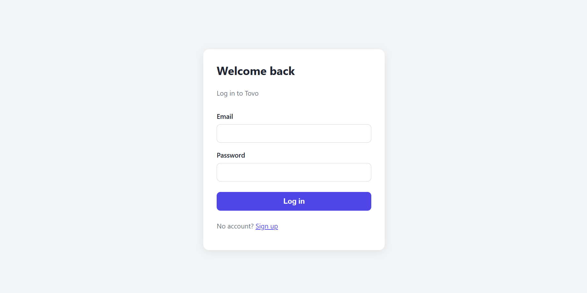
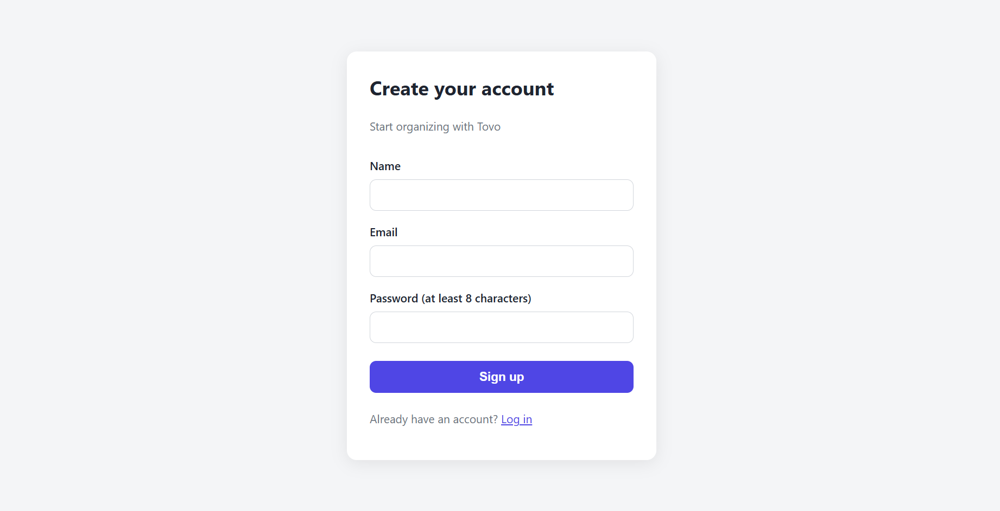
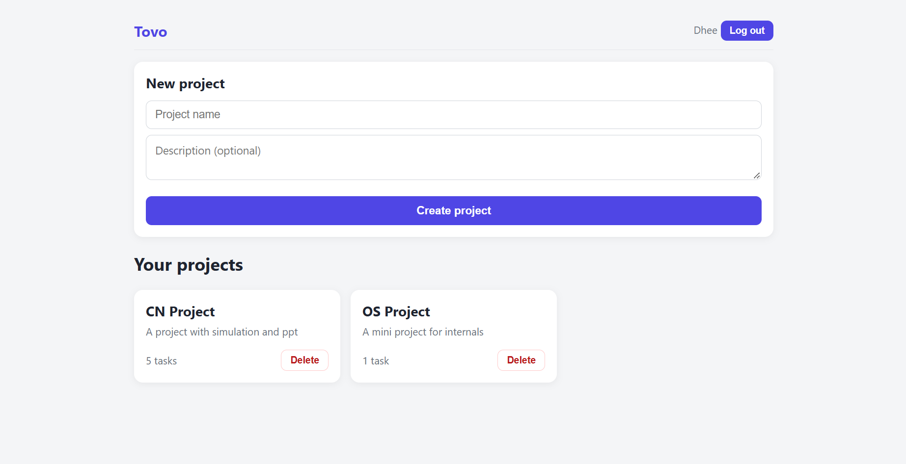
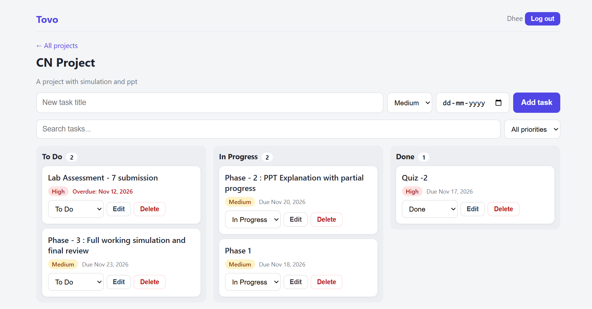
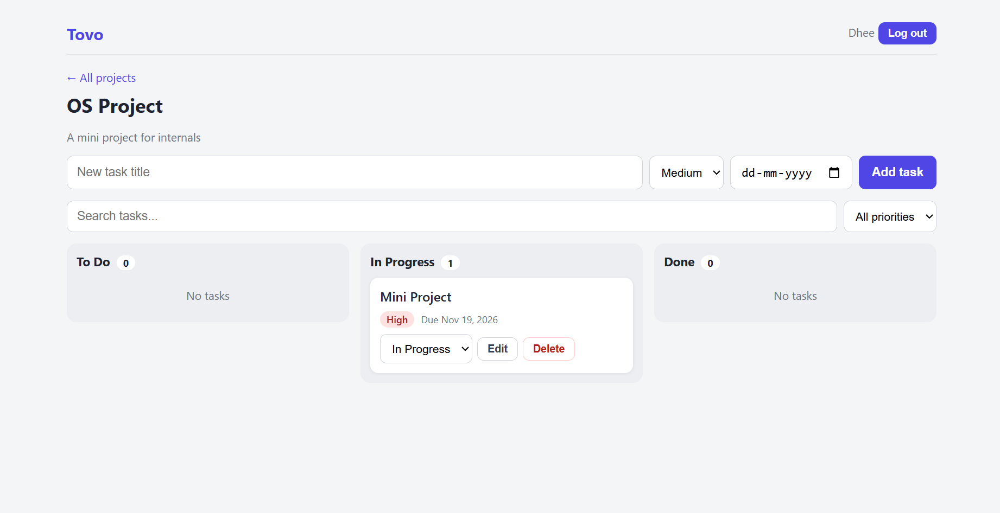

# Tovo: Task Management App

A full-stack task management app. Create projects, add tasks, set priorities and due dates, and move tasks between To Do, In Progress, and Done.

**Live demo:** https://tovo-coral.vercel.app

> The backend runs on a free plan and goes to sleep when unused. The first request may take up to a minute to wake it up.

## Screenshots







## Features
- Sign up and log in securely (JWT authentication, bcrypt password hashing)
- Create and delete projects
- Add, edit, move, and delete tasks with priority and due dates
- Overdue tasks highlighted in red
- Search and filter by priority
- Each user can only see their own projects and tasks

## Tech stack
- **Frontend:** React (Vite), React Router, Axios
- **Backend:** Node.js, Express
- **Database:** PostgreSQL (Neon)
- **Hosting:** Vercel (frontend), Render (backend)

## Security
- Passwords are hashed and never stored in plain text
- Parameterized SQL queries to prevent SQL injection
- Ownership checks on every project and task request
- Helmet security headers, rate limiting, and a CORS allowlist
- Secrets are kept in environment variables and never committed

## Run locally
1. Clone the repo
2. Create a free Neon database and run `server/schema.sql` in its SQL Editor
3. Inside `server/`, create a `.env` file:
   ```
   DATABASE_URL=your_connection_string
   JWT_SECRET=a_random_string_of_32_or_more_characters
   PORT=5000
   CLIENT_URL=http://localhost:5173
   ```
4. Backend: `cd server`, then `npm install`, then `npm run dev`
5. Frontend: `cd client`, then `npm install`, then `npm run dev`
6. Open http://localhost:5173

## Planned improvements
- Invite team members with roles
- Real-time updates
- Drag and drop between columns
- Automated tests